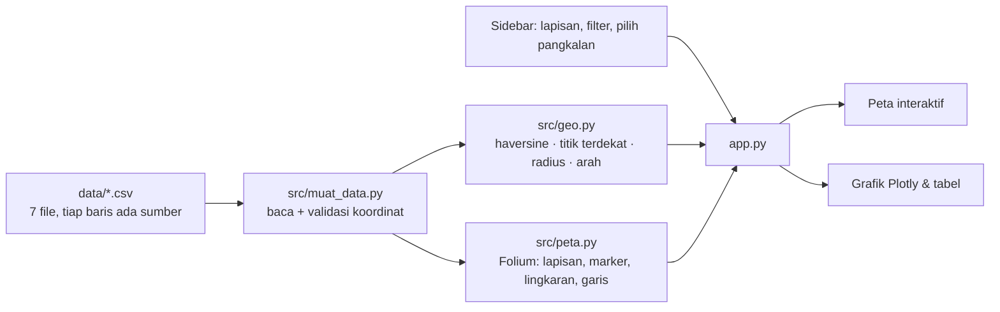

# 🛡️ WebGIS Pertahanan Indonesia

> Peta interaktif **markas TNI**, **pulau terluar & perbatasan**, **ALKI**, dan **pangkalan militer asing di
> kawasan**, lengkap dengan lingkaran jarak, analisis markas TNI terdekat, dan tab statistik anggaran pertahanan.
> Dibangun dengan Python, pandas, Folium (Leaflet), Plotly, dan Streamlit.

*An interactive WebGIS of Indonesia's defense geography: TNI bases, outermost islands and border posts,
archipelagic sea lanes (ALKI), and foreign military bases in the region with range rings and
nearest-base analysis. Built with Python, pandas, Folium, Plotly and Streamlit using public data only.*


> ℹ️ **Disclaimer.** Semua titik di project ini berasal dari **sumber publik** (Wikipedia, situs resmi, media, laporan
> think tank seperti CSIS AMTI dan SIPRI). Koordinat adalah perkiraan lokasi umum, bukan data operasional.
> Ini project edukasi dan portofolio pribadi, bukan dokumen resmi, dan tidak berafiliasi dengan instansi mana pun.

## Kenapa project ini ada?

Gw penasaran: kalau semua markas TNI, pulau terluar, dan pangkalan militer negara lain di sekitar Indonesia
ditaruh di satu peta, apa yang kelihatan? Seberapa jauh pos China di Spratly dari Natuna? Markas TNI mana yang
paling dekat ke pangkalan AS di Darwin? Jawabannya ternyata lebih gampang dilihat lewat peta daripada dibaca
dari artikel. Project ini sekaligus jadi latihan bikin **Sistem Informasi Geografis berbasis web (WebGIS)**
pakai Python: koordinat, lapisan peta, buffer radius, dan pencarian tetangga terdekat.

## Fitur

| Tab | Isi |
|---|---|
| 🗺️ Peta | Peta Folium dengan 5 lapisan yang bisa dinyalakan/dimatikan: markas TNI (warna per matra), pulau terluar & pos perbatasan, ALKI I/II/III, pangkalan asing (warna per negara), lingkaran jarak 250/500/1.000/1.500 km. Pilih satu pangkalan asing → peta menarik garis ke markas TNI dan batas Indonesia terdekat |
| 📏 Analisis Jarak | Untuk semua pangkalan asing: jarak ke pulau terluar terdekat, markas TNI terdekat, arah kompas, jumlah markas TNI dalam 500 / 1.000 km. Grafik + tabel yang bisa diurutkan |
| 📊 Statistik | Anggaran Kemhan 2015–2026, % PDB, belanja militer kawasan (SIPRI 2024) dalam skala log, alutsista utama per matra |
| 📋 Data & Sumber | Semua tabel + link sumber per baris + unduh CSV + catatan kejujuran data |
| 🧭 Cara Kerja | Diagram alur data → rumus → peta, plus konsep GIS yang dipakai |
| 🎓 Mode belajar | Toggle di sidebar: tiap bagian dapat expander berisi rumus (haversine), potongan kode, dan penjelasan |


## Cara menjalankan

```bash
git clone <url-repo-ini>
cd indonesia-defense-gis
python -m venv .venv && source .venv/bin/activate   # Windows: .venv\Scripts\activate
pip install -r requirements.txt
streamlit run app.py
```

Buka `http://localhost:8501`. Jalankan tes dengan `python -m pytest tests/ -v` (11 tes).
Peta dasar diambil dari server tile Esri / OpenStreetMap, jadi butuh koneksi internet.

## Cara kerja (ringkas)



Rumus inti ada di `src/geo.py` (murni Python, ada docstring + contoh angka):

| Fungsi | Apa yang dihitung |
|---|---|
| `haversine_km(lat1, lon1, lat2, lon2)` | Jarak great-circle dua koordinat (bumi dianggap bola, R = 6.371 km) |
| `titik_terdekat(lat, lon, df)` | Baris DataFrame yang paling dekat + jaraknya (nearest neighbour) |
| `jumlah_dalam_radius(lat, lon, df, r)` | Berapa titik dalam radius r km (buffer sederhana) |
| `arah_kompas(...)` | Bearing → 8 mata angin (U, TL, T, TG, S, BD, B, BL) |
| `tabel_jarak(asing, tni, pulau)` | Gabungan semua di atas untuk tiap pangkalan asing |

## Data

Tujuh file CSV di `data/`, semua dari sumber publik dengan kolom `sumber` dan `url_sumber` per baris:

| File | Isi | Baris |
|---|---|---|
| `markas_tni.csv` | Mabes TNI, 3 Kogabwilhan, 15 Kodam, Kostrad, 3 Koarmada, 14 Lantamal, Lanal Ranai, 27 Lanud | 65 |
| `pulau_terluar_perbatasan.csv` | 15 pulau terluar, 6 PLBN darat, 3 wilayah rawan (Natuna Utara, Ambalat, Selat Malaka) | 24 |
| `pangkalan_asing.csv` | Pangkalan militer asing di kawasan: Australia, AS (Guam, Diego Garcia, Darwin), China (Spratly, Paracel, Hainan, Ream), Singapura, Malaysia, Filipina/EDCA, Vietnam, India (Nicobar), PNG, Inggris (Brunei), Thailand | 37 |
| `alki.csv` | Titik-titik ilustrasi ALKI I, II, III | 18 |
| `anggaran_indonesia.csv` | Pagu APBN Kemhan 2015–2026 + % PDB | 12 |
| `anggaran_kawasan.csv` | Belanja militer 2024 (SIPRI) 10 negara kawasan | 10 |
| `alutsista.csv` | Alutsista utama per matra (perkiraan publik) | 13 |

Catatan kejujuran data ada di [`data/SUMBER_DATA.md`](data/SUMBER_DATA.md): koordinat = perkiraan, ALKI =
ilustrasi, daftar markas mengikuti Wikipedia dan bisa tertinggal dari reorganisasi terbaru, angka anggaran =
pembulatan dengan kolom `keyakinan`.

## Catatan analisis (pendapat pribadi)

Label di peta sengaja netral: **"pangkalan asing di kawasan"**, bukan "ancaman". Sebagian besar justru milik negara
mitra (Singapura, Malaysia, Australia, India). Dari angka-angka di tab Analisis Jarak, beberapa hal yang menurut gw
menarik:

1. **Yang paling dekat secara geografis bukan yang paling mengkhawatirkan.** Pangkalan Singapura hanya 27–45 km dari
   Pulau Nipa, dan INS Baaz (India) 166 km dari Pulau Rondo, tapi keduanya mitra dekat Indonesia.
2. **Pos China di Spratly berjarak 530–860 km dari Natuna** dan tidak ada markas TNI dalam radius 500 km dari pos-pos
   itu; dalam 1.000 km hanya ada Natuna dan Kalimantan Utara. Ini sejalan dengan kenapa TNI terus memperkuat Natuna
   sejak 2016.
3. **Sisi selatan dan timur** relatif "kosong": Darwin dan Tindal (Australia, dengan rotasi Marinir dan rencana B-52 AS)
   berjarak 475–720 km dari Pulau Selaru, sementara Lombrum (Manus) dan Port Moresby (PNG, didukung AS/Australia)
   berjarak ~700 km dari Papua. Di sisi ini pangkalan TNI terdekat adalah Lanud El Tari Kupang dan Merauke.
4. **Selat Malaka adalah titik temu**: pangkalan Malaysia, Singapura, India, dan Thailand (akses AS) semuanya dalam
   1.000 km dari pantai timur Sumatera; wajar kalau Koarmada I dipindah ke Tanjung Pinang.

Jarak cuma satu faktor. Niat politik, jenis alutsista, jangkauan rudal/pesawat, dan aliansi jauh lebih menentukan.
Angka di sini bahan diskusi, bukan kesimpulan.

## Struktur repo

```
indonesia-defense-gis/
├── app.py                  # tampilan Streamlit (baca dari atas ke bawah)
├── src/
│   ├── muat_data.py        # baca & validasi CSV
│   ├── geo.py              # haversine, titik terdekat, radius, arah (murni Python, dites)
│   └── peta.py             # bangun peta Folium per lapisan
├── data/                   # 7 CSV + SUMBER_DATA.md
├── tests/test_geo.py       # 11 tes pytest
├── docs/
│   ├── BELAJAR.md          # panduan belajar step by step (GIS, Folium, haversine)
│   ├── LATIHAN.md          # latihan kecil + kunci jawaban
│   └── screenshots/
└── requirements.txt
```

## Belajar dari project ini

Baru kenal GIS? Baca [`docs/BELAJAR.md`](docs/BELAJAR.md) dulu (koordinat, lapisan, haversine, cara Folium
bekerja di dalam Streamlit), lalu kerjakan [`docs/LATIHAN.md`](docs/LATIHAN.md). Nyalakan **Mode belajar** di
sidebar supaya tiap bagian menunjukkan kode di baliknya.

## Rencana berikutnya

- [ ] Tambah poligon ZEE Indonesia dan garis sembilan putus China (GeoJSON) supaya tumpang tindih klaim kelihatan.
- [ ] Tambah lapisan jangkauan alutsista (mis. radius tempur pesawat dari tiap Lanud).
- [ ] Ganti CSV dengan GeoJSON + GeoPandas untuk operasi spasial sungguhan (buffer, intersect).
- [ ] Versi Leaflet.js murni + API FastAPI supaya bisa di-embed di web mana pun.
- [ ] Deploy ke Streamlit Community Cloud.

## Lisensi

Kode: MIT. Data: kompilasi dari sumber publik yang disebutkan di tiap baris; gunakan dengan menyebut sumber aslinya.
