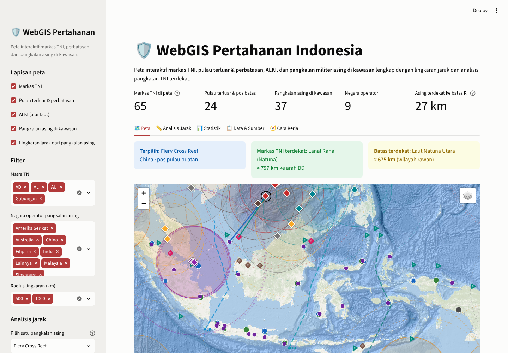
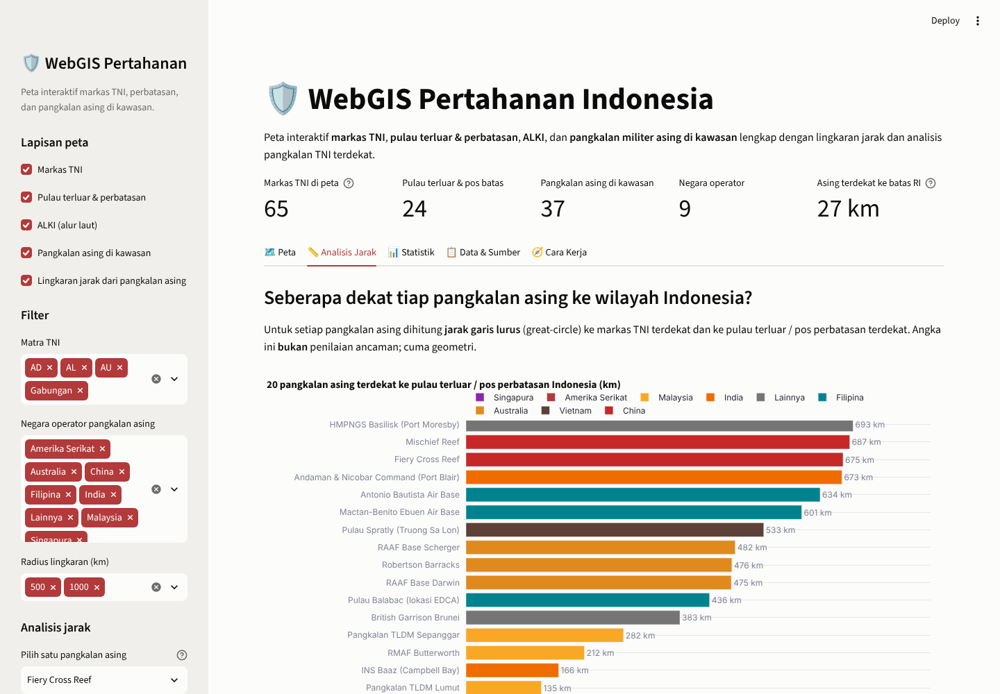
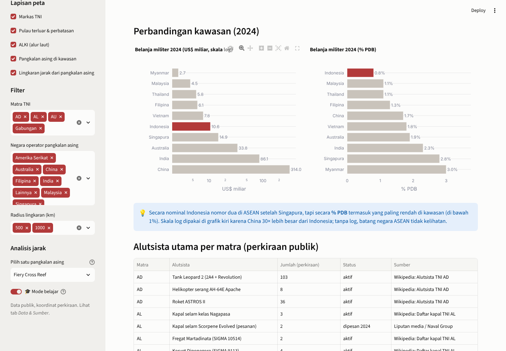
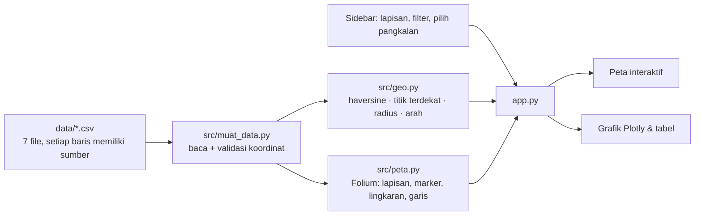

# 🛡️ WebGIS Pertahanan Indonesia

> Peta interaktif **markas TNI**, **pulau terluar & perbatasan**, **ALKI**, dan **pangkalan militer asing di
> kawasan**, dilengkapi lingkaran jarak, analisis markas TNI terdekat, dan tab statistik anggaran pertahanan.
> Dibangun dengan Python, pandas, Folium (Leaflet), Plotly, dan Streamlit.

*An interactive WebGIS of Indonesia's defense geography: TNI bases, outermost islands and border posts,
archipelagic sea lanes (ALKI), and foreign military bases in the region with range rings and
nearest-base analysis. Built with Python, pandas, Folium, Plotly and Streamlit using public data only.*

**🚀 Coba langsung di browser:** [indonesia-defense-gis.streamlit.app](https://indonesia-defense-gis.streamlit.app)



> ℹ️ **Disclaimer.** Seluruh titik dalam proyek ini berasal dari **sumber publik** (Wikipedia, situs resmi, media, laporan
> lembaga kajian seperti CSIS AMTI dan SIPRI). Koordinat merupakan perkiraan lokasi umum, bukan data operasional.
> Proyek ini bersifat edukatif dan merupakan portofolio pribadi, bukan dokumen resmi, serta tidak berafiliasi dengan instansi mana pun.

## Latar belakang

Proyek ini berangkat dari pertanyaan sederhana: jika seluruh markas TNI, pulau terluar, dan pangkalan militer negara
lain di sekitar Indonesia ditempatkan pada satu peta, pola apa yang terlihat? Seberapa jauh pos China di Kepulauan
Spratly dari Natuna? Markas TNI mana yang paling dekat dengan pangkalan AS di Darwin? Pertanyaan semacam ini jauh
lebih mudah dijawab lewat peta daripada lewat teks. Sekaligus, proyek ini menjadi latihan membangun **Sistem Informasi
Geografis berbasis web (WebGIS)** dengan Python: koordinat, lapisan peta, buffer radius, dan pencarian tetangga terdekat.

## Fitur

| Tab | Isi |
|---|---|
| 🗺️ Map | Peta Folium dengan 5 lapisan yang dapat diaktifkan/dinonaktifkan: markas TNI (warna per matra), pulau terluar & pos perbatasan, ALKI I/II/III, pangkalan asing (warna per negara), lingkaran jarak 250/500/1.000/1.500 km. Memilih satu pangkalan asing akan menarik garis ke markas TNI dan batas Indonesia terdekat |
| 📏 Distance analysis | Untuk setiap pangkalan asing: jarak ke pulau terluar terdekat, markas TNI terdekat, arah kompas, serta jumlah markas TNI dalam radius 500 / 1.000 km. Disajikan dalam grafik dan tabel yang dapat diurutkan |
| 📊 Stats | Anggaran Kemhan 2015–2026, persentase PDB, belanja militer kawasan (SIPRI 2024) dalam skala logaritmik, dan alutsista utama per matra |
| 📋 Data & Sources | Seluruh tabel beserta tautan sumber per baris, download CSV, dan catatan keterbatasan data |
| 🧭 How it works | Diagram alur data → rumus → peta, beserta konsep GIS yang digunakan |
| 🎓 Learning mode | Toggle di sidebar: setiap bagian menampilkan expander berisi rumus (haversine), potongan kode, dan penjelasan |




## Cara menjalankan

```bash
git clone https://github.com/Avalon2222/indonesia-defense-gis.git
cd indonesia-defense-gis
python -m venv .venv && source .venv/bin/activate   # Windows: .venv\Scripts\activate
pip install -r requirements.txt
streamlit run app.py
```

Buka `http://localhost:8501`. Jalankan pengujian dengan `python -m pytest tests/ -v` (11 tes).
Peta dasar diambil dari server tile Esri / OpenStreetMap sehingga memerlukan koneksi internet.

## Cara kerja (ringkas)



Rumus inti berada di `src/geo.py` (murni Python, dilengkapi docstring dan contoh angka):

| Fungsi | Yang dihitung |
|---|---|
| `haversine_km(lat1, lon1, lat2, lon2)` | Jarak great-circle dua koordinat (bumi dianggap bola, R = 6.371 km) |
| `titik_terdekat(lat, lon, df)` | Baris DataFrame yang paling dekat beserta jaraknya (nearest neighbour) |
| `jumlah_dalam_radius(lat, lon, df, r)` | Jumlah titik dalam radius r km (buffer sederhana) |
| `arah_kompas(...)` | Bearing → 8 mata angin (U, TL, T, TG, S, BD, B, BL) |
| `tabel_jarak(asing, tni, pulau)` | Gabungan seluruh fungsi di atas untuk setiap pangkalan asing |

## Data

Tujuh file CSV di `data/`, seluruhnya dari sumber publik dengan kolom `sumber` dan `url_sumber` pada setiap baris:

| File | Isi | Baris |
|---|---|---|
| `markas_tni.csv` | Mabes TNI, 3 Kogabwilhan, 15 Kodam, Kostrad, 3 Koarmada, 14 Lantamal, Lanal Ranai, 27 Lanud | 65 |
| `pulau_terluar_perbatasan.csv` | 15 pulau terluar, 6 PLBN darat, 3 wilayah rawan (Natuna Utara, Ambalat, Selat Malaka) | 24 |
| `pangkalan_asing.csv` | Pangkalan militer asing di kawasan: Australia, AS (Guam, Diego Garcia, Darwin), China (Spratly, Paracel, Hainan, Ream), Singapura, Malaysia, Filipina/EDCA, Vietnam, India (Nicobar), PNG, Inggris (Brunei), Thailand | 37 |
| `alki.csv` | Titik-titik ilustrasi ALKI I, II, III | 18 |
| `anggaran_indonesia.csv` | Pagu APBN Kemhan 2015–2026 beserta persentase PDB | 12 |
| `anggaran_kawasan.csv` | Belanja militer 2024 (SIPRI) 10 negara kawasan | 10 |
| `alutsista.csv` | Alutsista utama per matra (perkiraan publik) | 13 |

Catatan keterbatasan data tersedia di [`data/SUMBER_DATA.md`](data/SUMBER_DATA.md): koordinat adalah perkiraan, ALKI
bersifat ilustratif, daftar markas mengikuti Wikipedia dan dapat tertinggal dari reorganisasi terbaru, serta angka
anggaran merupakan pembulatan dengan kolom `keyakinan`.

## Catatan analisis (pendapat pribadi)

Label pada peta sengaja dibuat netral, yaitu **"pangkalan asing di kawasan"**, bukan "ancaman". Sebagian besar justru
milik negara mitra (Singapura, Malaysia, Australia, India). Dari angka pada tab Analisis Jarak, beberapa hal yang
menarik untuk dicermati:

1. **Yang paling dekat secara geografis belum tentu yang paling perlu diwaspadai.** Pangkalan Singapura hanya 27–45 km
   dari Pulau Nipa, dan INS Baaz (India) 166 km dari Pulau Rondo, tetapi keduanya adalah mitra dekat Indonesia.
2. **Pos China di Spratly berjarak 530–860 km dari Natuna** dan tidak ada markas TNI dalam radius 500 km dari pos-pos
   tersebut; dalam radius 1.000 km hanya ada Natuna dan Kalimantan Utara. Ini sejalan dengan penguatan Natuna oleh TNI
   sejak 2016.
3. **Sisi selatan dan timur** relatif "kosong": Darwin dan Tindal (Australia, dengan rotasi Marinir AS dan rencana
   fasilitas B-52) berjarak 475–720 km dari Pulau Selaru, sementara Lombrum (Manus) dan Port Moresby (PNG, didukung
   AS/Australia) berjarak sekitar 700 km dari Papua. Pangkalan TNI terdekat di sisi ini adalah Lanud El Tari Kupang dan Merauke.
4. **Selat Malaka adalah titik temu**: pangkalan Malaysia, Singapura, India, dan Thailand (dengan akses AS) seluruhnya
   berada dalam 1.000 km dari pantai timur Sumatera. Pemindahan Koarmada I ke Tanjung Pinang menjadi masuk akal.

Jarak hanya satu faktor. Niat politik, jenis alutsista, jangkauan rudal/pesawat, dan aliansi jauh lebih menentukan.
Angka di sini dimaksudkan sebagai bahan diskusi, bukan kesimpulan.

## Struktur repositori

```
indonesia-defense-gis/
├── app.py                  # tampilan Streamlit (dibaca dari atas ke bawah)
├── src/
│   ├── muat_data.py        # baca & validasi CSV
│   ├── geo.py              # haversine, titik terdekat, radius, arah (murni Python, diuji)
│   └── peta.py             # membangun peta Folium per lapisan
├── data/                   # 7 CSV + SUMBER_DATA.md
├── tests/test_geo.py       # 11 tes pytest
├── docs/
│   ├── BELAJAR.md          # panduan belajar bertahap (GIS, Folium, haversine)
│   ├── LATIHAN.md          # latihan beserta kunci jawaban
│   └── screenshots/
└── requirements.txt
```

## Belajar dari proyek ini

Bagi yang baru mengenal GIS, mulailah dari [`docs/BELAJAR.md`](docs/BELAJAR.md) (koordinat, lapisan, haversine, cara
Folium bekerja di dalam Streamlit), lalu kerjakan [`docs/LATIHAN.md`](docs/LATIHAN.md). Aktifkan **Mode belajar** di
sidebar agar setiap bagian menampilkan kode di baliknya.

## Rencana pengembangan

- [ ] Menambahkan poligon ZEE Indonesia dan garis sembilan putus China (GeoJSON) agar tumpang tindih klaim terlihat.
- [ ] Menambahkan lapisan jangkauan alutsista (misalnya radius tempur pesawat dari setiap Lanud).
- [ ] Mengganti CSV dengan GeoJSON + GeoPandas untuk operasi spasial yang sesungguhnya (buffer, intersect).
- [ ] Versi Leaflet.js murni + API FastAPI agar dapat disematkan di situs web mana pun.
- [ ] Deploy ke Streamlit Community Cloud.

## Lisensi

Kode: MIT. Data: kompilasi dari sumber publik yang disebutkan pada setiap baris; gunakan dengan menyebut sumber aslinya.
