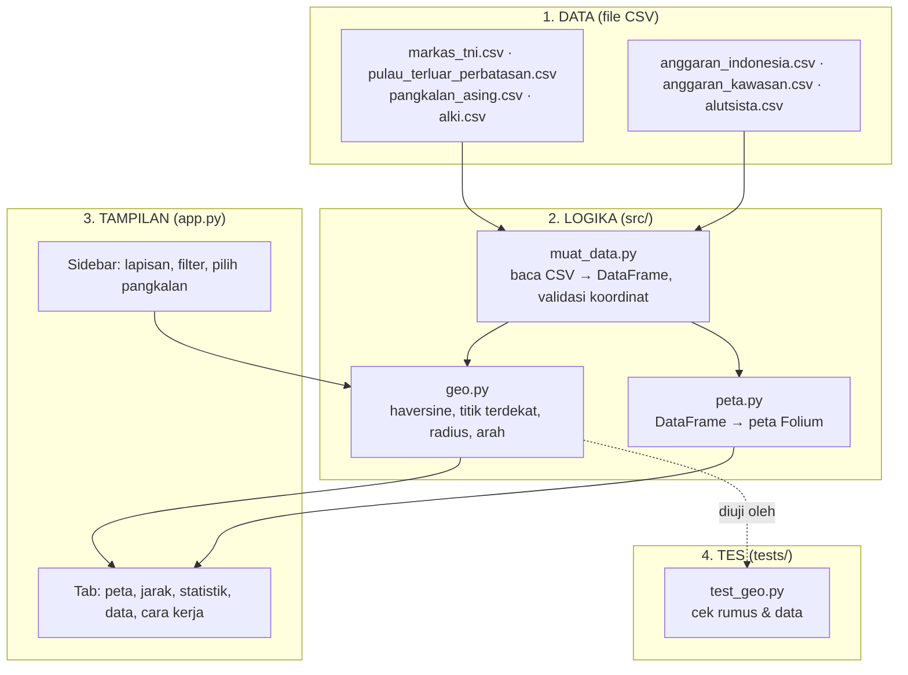
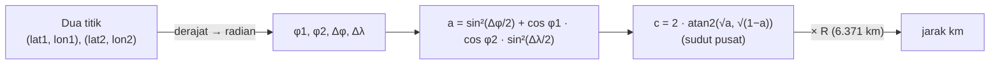
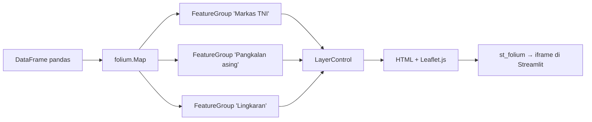

# 🎓 Panduan Belajar: Bikin WebGIS dari Nol

Panduan ini buat kamu yang baru tahu Python "sedikit-sedikit" dan belum pernah pegang GIS. Tujuannya bukan
ngafalin kode, tapi **paham kenapa kodenya begitu**. Baca pelan-pelan, buka file yang disebut, dan coba ubah
sesuatu di tiap bagian. Kalau rusak, `git checkout app.py` balikin lagi.

Estimasi waktu: 3–4 jam santai, dibagi beberapa sesi.

---

## Peta besar: 4 lapisan kode



**Kenapa dipisah?** Supaya tiap bagian bisa diubah tanpa merusak yang lain:

- Mau nambah pangkalan? Edit **CSV**. Nggak perlu sentuh kode.
- Mau ganti rumus jarak? Edit **geo.py**, jalankan tes, selesai.
- Mau ganti warna marker? Edit **peta.py** aja.

---

## Langkah 1 — Koordinat: bahasa dasar GIS

Setiap titik di bumi punya dua angka:

| Istilah | Arti | Rentang | Contoh Jakarta |
|---|---|---|---|
| **Lintang (latitude, `lat`)** | Seberapa jauh dari khatulistiwa. Negatif = selatan | -90 … 90 | -6.21 |
| **Bujur (longitude, `lon`)** | Seberapa jauh dari garis Greenwich. Positif = timur | -180 … 180 | 106.85 |

Indonesia membentang kira-kira lintang **6° U sampai 11° S** dan bujur **95° sampai 141° T**. Itulah kenapa
`muat_data.py` menolak koordinat di luar kotak itu: salah ketik `6.2` jadi `-6.2`... masih di Indonesia, tapi
`62` langsung ditolak.

```python
import pandas as pd
df = pd.read_csv("data/markas_tni.csv")
df[["nama", "lat", "lon"]].head()
df[df["lat"] > 0]                 # markas di utara khatulistiwa
df.groupby("matra").size()        # berapa markas per matra
```

Jebakan klasik: Folium dan Leaflet pakai urutan **[lat, lon]**, tapi banyak library lain (GeoJSON, Plotly) pakai
**[lon, lat]**. Kalau petamu tiba-tiba kosong atau titiknya di Afrika, 90% itu masalahnya.

---

## Langkah 2 — Jarak di bola: rumus haversine (src/geo.py)

Bumi bukan bidang datar, jadi Pythagoras biasa salah. Rumus **haversine** menghitung panjang busur di permukaan bola:



Coba di `python`:

```python
from src import geo
geo.haversine_km(-6.21, 106.85, 1.35, 103.82)   # Jakarta → Singapura ≈ 900 km
geo.haversine_km(3.95, 108.38, 9.55, 112.89)    # Ranai (Natuna) → Fiery Cross Reef ≈ 797 km
geo.haversine_km(0, 100, 1, 100)                # 1° lintang ≈ 111 km (angka bagus buat diingat)
```

Kenapa `atan2` bukan `asin`? Secara matematika sama, tapi `atan2` lebih stabil untuk jarak sangat kecil atau
hampir setengah lingkaran. Ini detail yang bakal kamu temui di banyak library.

**Tiga fungsi turunan** yang dibangun dari haversine:

| Fungsi | Cara kerja | Istilah GIS |
|---|---|---|
| `jarak_ke_semua(lat, lon, df)` | hitung haversine ke tiap baris → Series | distance matrix (satu baris) |
| `titik_terdekat(lat, lon, df)` | `jarak_ke_semua(...).idxmin()` | nearest neighbour |
| `jumlah_dalam_radius(lat, lon, df, r)` | `(jarak <= r).sum()` | buffer + count |

Semuanya "brute force": hitung ke semua titik lalu ambil minimum. Untuk 65 titik itu instan. Untuk jutaan titik
orang pakai struktur data khusus (KD-tree, R-tree); itu bab berikutnya kalau kamu lanjut ke GeoPandas.

---

## Langkah 3 — Tes (tests/test_geo.py)

Jalankan `python -m pytest tests/ -v`. Ada 11 tes. Yang paling berguna:

- `test_haversine_satu_derajat_lintang_111km` — kalau kamu salah konversi derajat/radian, ini langsung merah.
- `test_dataset_bisa_dimuat_dan_valid` — menolak koordinat di luar Indonesia dan URL sumber yang kosong.
- `test_tabel_jarak_bentuk` — memastikan tabel jarak terurut dan INS Baaz (Nicobar) ada di daftar terdekat.

Tes itu cuma fungsi `test_...` berisi `assert`. Kebiasaan bagus: setiap ubah rumus atau data → jalankan tes.

---

## Langkah 4 — Folium: peta web dari Python (src/peta.py)

**Folium** adalah pembungkus Python untuk **Leaflet.js**, library JavaScript peta yang dipakai di jutaan situs.
Kamu nulis Python, Folium menghasilkan HTML + JS, Streamlit menempelkannya sebagai iframe.



Pola yang berulang di `peta.py`:

```python
m = folium.Map(location=[-2, 118], zoom_start=5)          # 1. kanvas, pusat di Indonesia
fg = folium.FeatureGroup(name="Markas TNI")                # 2. satu grup = satu lapisan
for _, b in df_tni.iterrows():                             # 3. satu marker per baris
    folium.CircleMarker([b["lat"], b["lon"]], radius=7,
                        fill_color=WARNA_MATRA[b["matra"]],
                        tooltip=b["nama"]).add_to(fg)
fg.add_to(m)                                               # 4. tempel grup ke peta
folium.LayerControl().add_to(m)                            # 5. kotak centang lapisan
```

Objek Folium yang dipakai di project ini:

| Objek | Untuk apa | Catatan |
|---|---|---|
| `TileLayer` | Gambar latar (Esri Ocean / OpenStreetMap) | diambil dari server per kotak kecil ("tile") |
| `CircleMarker` | Titik dengan radius dalam **piksel** | ukurannya tetap saat zoom |
| `Circle` | Lingkaran dengan radius dalam **meter** | ukurannya ikut skala peta → cocok buat "radius 500 km" |
| `RegularPolygonMarker` | Segitiga/kotak untuk pulau & pos | bentuk beda = kategori beda |
| `DivIcon` | Marker dari HTML sendiri (belah ketupat pangkalan asing) | fleksibel, tanpa file gambar |
| `PolyLine` | Garis ALKI dan garis analisis | `dash_array` bikin putus-putus |
| `Popup` / tooltip | Info saat klik / hover | isinya HTML kecil dari `_popup()` |

Zoom-out sedikit, lalu perhatikan: `CircleMarker` ukurannya tetap, `Circle` mengecil. Itu beda piksel vs meter.

---

## Langkah 5 — Streamlit + Folium: cara berpikir "rerun dari atas"

> **Setiap kali kamu geser widget, Streamlit menjalankan ulang SELURUH `app.py` dari baris pertama.**

```mermaid
sequenceDiagram
    participant U as Kamu (browser)
    participant S as Streamlit (app.py)
    U->>S: buka halaman
    S->>S: baca CSV (cache), bikin sidebar, hitung jarak, bangun peta Folium
    S-->>U: tampilkan halaman
    U->>S: pilih "Fiery Cross Reef" di selectbox
    S->>S: jalankan ULANG dari atas; terpilih = Fiery Cross; peta dibangun lagi + garis analisis
    S-->>U: peta & kotak info sudah berubah
```

Dua hal khusus peta:

1. **`@st.cache_data`** di `ambil_data()` dan `ambil_tabel_jarak()`: CSV dan tabel 37×65 jarak cuma dihitung sekali.
2. **`st_folium(m, returned_objects=[])`**: tanpa `returned_objects=[]`, setiap klik/geser di peta mengirim event
   balik ke Python dan memicu rerun. Buat dashboard begini itu bikin lemot. Kalau nanti kamu mau "klik titik →
   tampilkan detail", ganti jadi `returned_objects=["last_object_clicked"]`.

### Anatomi app.py

| Bagian | Yang terjadi |
|---|---|
| 0. Konfigurasi | `st.set_page_config`, teks `DISCLAIMER`, fungsi `rapikan()` gaya grafik |
| 1. Muat data | 7 CSV lewat `ambil_data()` (cache) |
| 2. Sidebar | checkbox lapisan, multiselect matra/negara/radius, selectbox pangkalan, toggle mode belajar |
| 3. Hitung | `titik_terdekat` untuk pangkalan terpilih; `tabel_jarak` untuk semua |
| 4. KPI | 5 `st.metric` |
| 5. Tab | peta (`buat_peta` → `st_folium`), jarak (Plotly + tabel), statistik, data, cara kerja |

---

## Langkah 6 — Plotly: grafik dalam satu baris

Pola yang dipakai di tab Jarak dan Statistik:

```python
fig = px.bar(df, x="jarak_pulau_km", y="nama", orientation="h",
             color="negara", color_discrete_map=WARNA_NEGARA, text="jarak_pulau_km")
fig.update_traces(texttemplate="%{text:,} km", textposition="outside")
st.plotly_chart(rapikan(fig, 640), use_container_width=True)
```

Tiga keputusan desain yang sengaja:

- **Warna konsisten**: `WARNA_NEGARA` dipakai di peta DAN grafik, jadi China selalu merah tua, Australia oranye.
- **Skala log** untuk belanja militer: China 30× Indonesia; tanpa log batang ASEAN jadi garis tipis.
- **Warna "abu-abu + satu merah"** di grafik kawasan: semua negara abu, Indonesia merah. Mata langsung tahu
  mana yang penting tanpa baca legenda.

---

## Langkah 7 — Membaca peta dengan jujur

Peta itu persuasif; gampang bikin orang percaya hal yang salah. Beberapa pengaman di project ini:

- Lingkaran radius **bukan jangkauan senjata**; cuma geometri. Ditulis di tooltip dan tab Cara Kerja.
- Label **"pangkalan asing di kawasan"**, bukan "musuh". Banyak di antaranya mitra.
- Setiap baris data punya **link sumber**. Kalau nggak bisa dicari di internet, nggak masuk.
- Disclaimer kecil di bawah peta dan di README.

Kalau kamu lanjut bikin peta tema sensitif lain (bencana, kesehatan, kriminalitas), prinsip yang sama berlaku.

---

## Langkah berikutnya (kalau mau naik level)

1. **GeoPandas + GeoJSON**: ganti CSV titik dengan poligon ZEE Indonesia. Kamu bisa `buffer()` dan `intersects()`
   sungguhan, bukan haversine manual.
2. **Leaflet.js murni + FastAPI**: pisahkan backend (API yang mengembalikan GeoJSON) dan frontend (HTML+JS).
   Ini arsitektur WebGIS "beneran" yang dipakai di industri.
3. **PostGIS**: simpan data di PostgreSQL dengan ekstensi spasial; query "markas dalam 500 km" jadi satu baris SQL.
