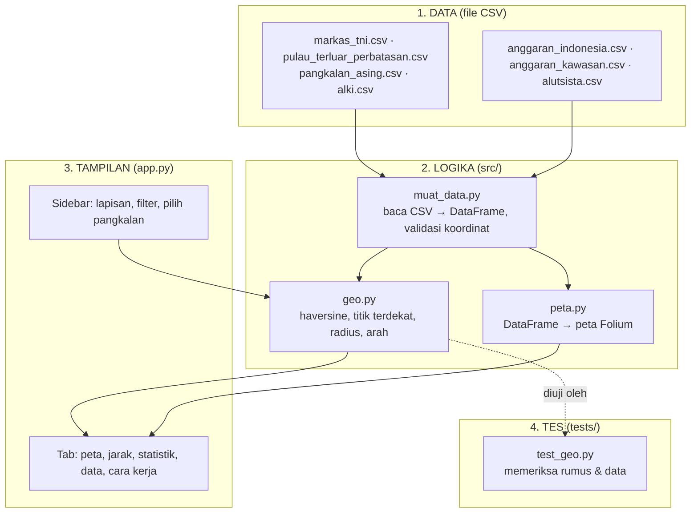
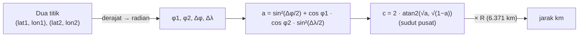
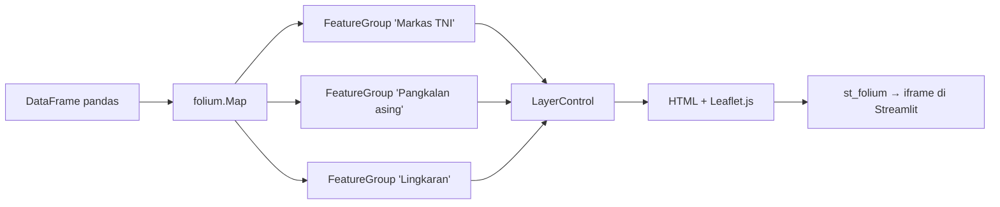

# 🎓 Panduan Belajar: Membangun WebGIS dari Nol

Panduan ini ditujukan bagi pembaca yang baru mengenal Python dan belum pernah bekerja dengan GIS. Tujuannya bukan
menghafal kode, melainkan **memahami mengapa kodenya ditulis demikian**. Bacalah perlahan, buka file yang disebut,
dan cobalah mengubah sesuatu di setiap bagian. Jika ada yang rusak, `git checkout app.py` akan mengembalikannya.

Perkiraan waktu: 3–4 jam, dapat dibagi ke beberapa sesi.

---

## Gambaran besar: 4 lapisan kode



**Mengapa dipisah?** Agar setiap bagian dapat diubah tanpa merusak bagian lain:

- Ingin menambah pangkalan? Cukup edit **CSV**, tanpa menyentuh kode.
- Ingin mengganti rumus jarak? Edit **geo.py**, jalankan tes, selesai.
- Ingin mengganti warna marker? Cukup edit **peta.py**.

---

## Langkah 1 — Koordinat: bahasa dasar GIS

Setiap titik di bumi dinyatakan dengan dua angka:

| Istilah | Arti | Rentang | Contoh Jakarta |
|---|---|---|---|
| **Lintang (latitude, `lat`)** | Jarak sudut dari khatulistiwa. Negatif = selatan | -90 … 90 | -6.21 |
| **Bujur (longitude, `lon`)** | Jarak sudut dari garis Greenwich. Positif = timur | -180 … 180 | 106.85 |

Indonesia membentang kira-kira pada lintang **6° LU sampai 11° LS** dan bujur **95° sampai 141° BT**. Karena itu
`muat_data.py` menolak koordinat di luar kotak tersebut: salah ketik `6.2` menjadi `-6.2` masih berada di Indonesia,
tetapi `62` langsung ditolak.

```python
import pandas as pd
df = pd.read_csv("data/markas_tni.csv")
df[["nama", "lat", "lon"]].head()
df[df["lat"] > 0]                 # markas di utara khatulistiwa
df.groupby("matra").size()        # jumlah markas per matra
```

Kesalahan klasik: Folium dan Leaflet memakai urutan **[lat, lon]**, sedangkan banyak pustaka lain (GeoJSON, Plotly)
memakai **[lon, lat]**. Jika peta tiba-tiba kosong atau titiknya muncul di Afrika, hampir pasti inilah penyebabnya.

---

## Langkah 2 — Jarak di permukaan bola: rumus haversine (src/geo.py)

Bumi bukan bidang datar, sehingga Pythagoras biasa tidak tepat. Rumus **haversine** menghitung panjang busur di
permukaan bola:



Coba di `python`:

```python
from src import geo
geo.haversine_km(-6.21, 106.85, 1.35, 103.82)   # Jakarta → Singapura ≈ 900 km
geo.haversine_km(3.95, 108.38, 9.55, 112.89)    # Ranai (Natuna) → Fiery Cross Reef ≈ 797 km
geo.haversine_km(0, 100, 1, 100)                # 1° lintang ≈ 111 km (angka yang berguna untuk diingat)
```

Mengapa `atan2`, bukan `asin`? Secara matematis keduanya setara, tetapi `atan2` lebih stabil untuk jarak yang sangat
kecil atau mendekati setengah lingkaran. Detail semacam ini akan sering dijumpai di berbagai pustaka.

**Tiga fungsi turunan** yang dibangun dari haversine:

| Fungsi | Cara kerja | Istilah GIS |
|---|---|---|
| `jarak_ke_semua(lat, lon, df)` | hitung haversine ke setiap baris → Series | distance matrix (satu baris) |
| `titik_terdekat(lat, lon, df)` | `jarak_ke_semua(...).idxmin()` | nearest neighbour |
| `jumlah_dalam_radius(lat, lon, df, r)` | `(jarak <= r).sum()` | buffer + count |

Semuanya bekerja secara "brute force": menghitung jarak ke seluruh titik lalu mengambil nilai minimum. Untuk 65 titik
prosesnya instan. Untuk jutaan titik, orang memakai struktur data khusus (KD-tree, R-tree); itu bab berikutnya jika
Anda melanjutkan ke GeoPandas.

---

## Langkah 3 — Pengujian (tests/test_geo.py)

Jalankan `python -m pytest tests/ -v`. Ada 11 tes. Yang paling berguna:

- `test_haversine_satu_derajat_lintang_111km` — jika konversi derajat/radian salah, tes ini langsung gagal.
- `test_dataset_bisa_dimuat_dan_valid` — menolak koordinat di luar Indonesia dan URL sumber yang kosong.
- `test_tabel_jarak_bentuk` — memastikan tabel jarak terurut dan INS Baaz (Nicobar) berada di daftar terdekat.

Tes hanyalah fungsi `test_...` yang berisi `assert`. Kebiasaan yang baik: setiap kali mengubah rumus atau data,
jalankan tes.

---

## Langkah 4 — Folium: peta web dari Python (src/peta.py)

**Folium** adalah pembungkus Python untuk **Leaflet.js**, pustaka JavaScript peta yang dipakai jutaan situs.
Anda menulis Python, Folium menghasilkan HTML + JS, dan Streamlit menempelkannya sebagai iframe.



Pola yang berulang di `peta.py`:

```python
m = folium.Map(location=[-2, 118], zoom_start=5)          # 1. kanvas, berpusat di Indonesia
fg = folium.FeatureGroup(name="Markas TNI")                # 2. satu grup = satu lapisan
for _, b in df_tni.iterrows():                             # 3. satu marker per baris
    folium.CircleMarker([b["lat"], b["lon"]], radius=7,
                        fill_color=WARNA_MATRA[b["matra"]],
                        tooltip=b["nama"]).add_to(fg)
fg.add_to(m)                                               # 4. tempelkan grup ke peta
folium.LayerControl().add_to(m)                            # 5. kotak centang lapisan
```

Objek Folium yang dipakai di proyek ini:

| Objek | Kegunaan | Catatan |
|---|---|---|
| `TileLayer` | Gambar latar (Esri Ocean / OpenStreetMap) | diambil dari server per kotak kecil ("tile") |
| `CircleMarker` | Titik dengan radius dalam **piksel** | ukurannya tetap saat zoom |
| `Circle` | Lingkaran dengan radius dalam **meter** | ukurannya mengikuti skala peta → cocok untuk "radius 500 km" |
| `RegularPolygonMarker` | Segitiga/kotak untuk pulau dan pos | bentuk berbeda = kategori berbeda |
| `DivIcon` | Marker dari HTML sendiri (belah ketupat pangkalan asing) | fleksibel, tanpa file gambar |
| `PolyLine` | Garis ALKI dan garis analisis | `dash_array` membuat garis putus-putus |
| `Popup` / tooltip | Informasi saat klik / hover | berisi HTML kecil dari `_popup()` |

Cobalah zoom-out sedikit dan perhatikan: `CircleMarker` ukurannya tetap, sedangkan `Circle` mengecil. Itulah
perbedaan piksel dan meter.

---

## Langkah 5 — Streamlit + Folium: cara berpikir "jalankan ulang dari atas"

> **Setiap kali widget diubah, Streamlit menjalankan ulang SELURUH `app.py` dari baris pertama.**

```mermaid
sequenceDiagram
    participant U as Pengguna (browser)
    participant S as Streamlit (app.py)
    U->>S: membuka halaman
    S->>S: baca CSV (cache), bangun sidebar, hitung jarak, bangun peta Folium
    S-->>U: tampilkan halaman
    U->>S: memilih "Fiery Cross Reef" di selectbox
    S->>S: jalankan ULANG dari atas; terpilih = Fiery Cross; peta dibangun lagi + garis analisis
    S-->>U: peta dan kotak informasi sudah berubah
```

Dua hal khusus untuk peta:

1. **`@st.cache_data`** pada `ambil_data()` dan `ambil_tabel_jarak()`: CSV dan tabel jarak 37×65 hanya dihitung sekali.
2. **`st_folium(m, returned_objects=[])`**: tanpa `returned_objects=[]`, setiap klik atau geser di peta mengirim event
   balik ke Python dan memicu rerun, yang membuat dashboard terasa lambat. Jika nanti dibutuhkan fitur "klik titik →
   tampilkan detail", ganti menjadi `returned_objects=["last_object_clicked"]`.

### Anatomi app.py

| Bagian | Yang terjadi |
|---|---|
| 0. Konfigurasi | `st.set_page_config`, teks `DISCLAIMER`, fungsi `rapikan()` untuk gaya grafik |
| 1. Muat data | 7 CSV lewat `ambil_data()` (cache) |
| 2. Sidebar | checkbox lapisan, multiselect matra/negara/radius, selectbox pangkalan, toggle mode belajar |
| 3. Hitung | `titik_terdekat` untuk pangkalan terpilih; `tabel_jarak` untuk seluruh pangkalan |
| 4. KPI | 5 `st.metric` |
| 5. Tab | peta (`buat_peta` → `st_folium`), jarak (Plotly + tabel), statistik, data, cara kerja |

---

## Langkah 6 — Plotly: grafik dalam satu baris

Pola yang dipakai di tab Jarak dan Statistik:

```python
fig = px.bar(df, x="jarak_pulau_km", y="nama", orientation="h",
             color="negara", color_discrete_map=WARNA_NEGARA, text="jarak_pulau_km")
fig.update_traces(texttemplate="%{text:,} km", textposition="outside")
st.plotly_chart(rapikan(fig, 640), use_container_width=True)
```

Tiga keputusan desain yang disengaja:

- **Warna konsisten**: `WARNA_NEGARA` dipakai di peta DAN grafik, sehingga China selalu merah tua dan Australia oranye.
- **Skala logaritmik** untuk belanja militer: China 30× Indonesia; tanpa log, batang negara ASEAN menjadi garis tipis.
- **Abu-abu + satu merah** pada grafik kawasan: semua negara abu-abu, Indonesia merah. Mata langsung menangkap yang
  penting tanpa membaca legenda.

---

## Langkah 7 — Membaca peta secara jujur

Peta bersifat persuasif dan mudah membuat orang memercayai hal yang keliru. Beberapa pengaman di proyek ini:

- Lingkaran radius **bukan jangkauan senjata**, hanya geometri. Hal ini ditulis di tooltip dan tab Cara Kerja.
- Label **"pangkalan asing di kawasan"**, bukan "musuh". Banyak di antaranya adalah mitra.
- Setiap baris data memiliki **tautan sumber**. Yang tidak dapat ditemukan di internet tidak dimasukkan.
- Disclaimer singkat di bawah peta dan di README.

Prinsip yang sama berlaku jika Anda membuat peta bertema sensitif lain (bencana, kesehatan, kriminalitas).

---

## Langkah berikutnya

1. **GeoPandas + GeoJSON**: ganti CSV titik dengan poligon ZEE Indonesia, sehingga `buffer()` dan `intersects()`
   dapat dilakukan secara spasial, bukan lewat haversine manual.
2. **Leaflet.js murni + FastAPI**: pisahkan backend (API yang mengembalikan GeoJSON) dan frontend (HTML+JS).
   Inilah arsitektur WebGIS yang umum dipakai di industri.
3. **PostGIS**: simpan data di PostgreSQL dengan ekstensi spasial; query "markas dalam 500 km" cukup satu baris SQL.
